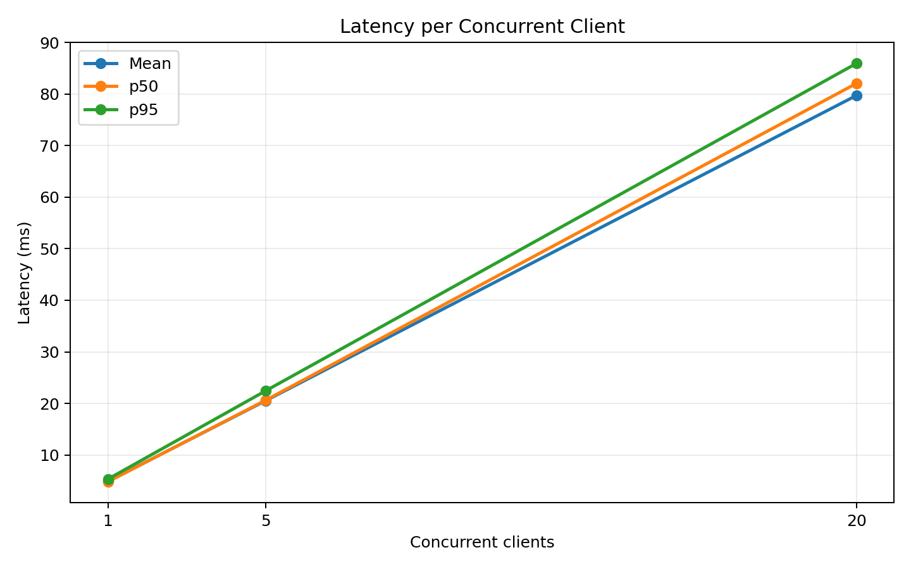
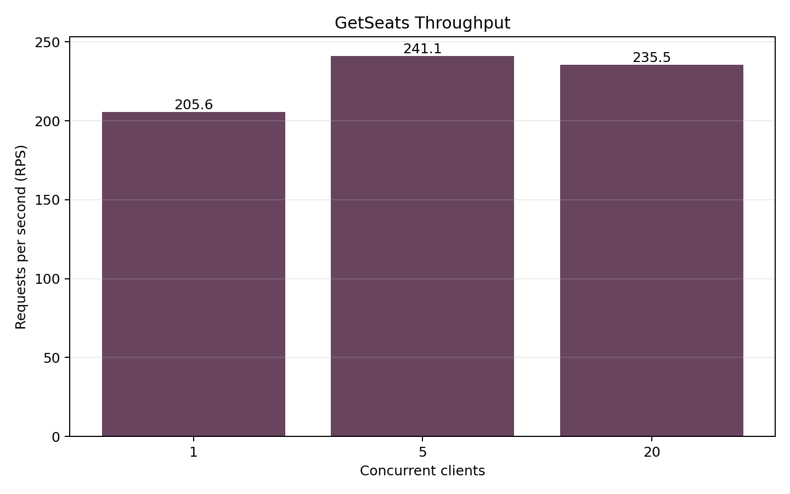
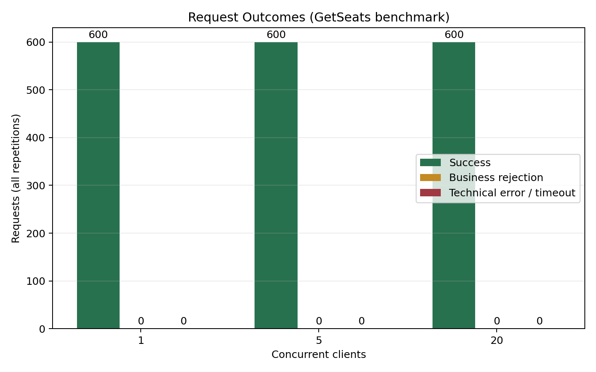
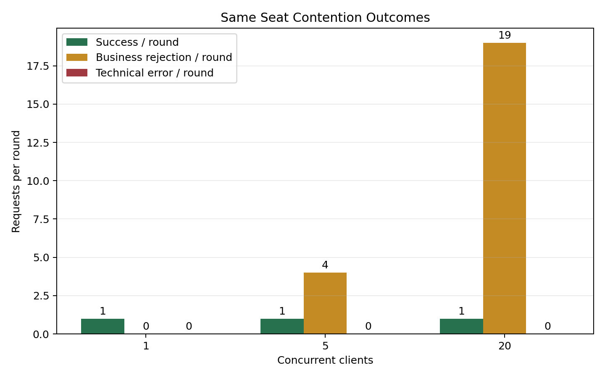

# Laporan Pengujian Cinema gRPC

## Tujuan dan lingkungan

Eksperimen menguji konsistensi perebutan kursi, idempotency saat respons hilang, pemulihan koneksi, streaming, dan performa RPC nyata.
Server gRPC lokal menggunakan loopback serta SQLite sementara yang dibuat ulang pada setiap pengulangan. Tidak ada data `data/cinema.db` yang disentuh.
Python: `3.13.14 (tags/v3.13.14:fd17997, Jun 10 2026, 13:03:48) [MSC v.1944 64 bit (AMD64)]`; OS: `Windows-11-10.0.26300-SP0`; grpcio: `1.85.0`; protobuf: `7.36.2`.

## Perintah reproduksi

```powershell
.\.venv\Scripts\python.exe -m scripts.run_experiments
```

## Test suite

```text
COMMAND: D:\Main Storage\Documents\kuliah\sem 5\Komputasi Paralel dan Terdistribusi\Mini Project\cinema-grpc\.venv\Scripts\python.exe -m unittest discover -s tests -v
EXIT CODE: 0

test_database_constraint_blocks_second_confirmed_booking (test_booking.BookingTests.test_database_constraint_blocks_second_confirmed_booking) ... ok
test_duplicate_returns_identical_result (test_booking.BookingTests.test_duplicate_returns_identical_result) ... ok
test_get_schedules (test_booking.BookingTests.test_get_schedules) ... ok
test_get_seats (test_booking.BookingTests.test_get_seats) ... ok
test_idempotency_conflict (test_booking.BookingTests.test_idempotency_conflict) ... ok
test_stream_snapshot_update_and_disconnect (test_booking.BookingTests.test_stream_snapshot_update_and_disconnect) ... ok
test_stream_unknown_schedule (test_booking.BookingTests.test_stream_unknown_schedule) ... ok
test_success_and_rejection_survive_restart (test_booking.BookingTests.test_success_and_rejection_survive_restart) ... ok
test_successful_booking (test_booking.BookingTests.test_successful_booking) ... ok
test_transaction_rolls_back_when_insert_fails (test_booking.BookingTests.test_transaction_rolls_back_when_insert_fails) ... ok
test_validation_and_missing_resources (test_booking.BookingTests.test_validation_and_missing_resources) ... ok
test_book_seat_success (test_client.ClientIntegrationTests.test_book_seat_success) ... ok
test_get_schedules (test_client.ClientIntegrationTests.test_get_schedules) ... ok
test_get_seats (test_client.ClientIntegrationTests.test_get_seats) ... ok
test_idempotent_retry_identical_request_id (test_client.ClientIntegrationTests.test_idempotent_retry_identical_request_id) ... ok
test_retry_callback_invoked_on_simulated_transient_failure (test_client.ClientIntegrationTests.test_retry_callback_invoked_on_simulated_transient_failure)
Uji bahwa saat terjadi DEADLINE_EXCEEDED, retry dipanggil dengan ID yang sama. ... [RETRY #1/3] Terjadi gangguan (DEADLINE_EXCEEDED). Mengulang dalam 0.03s dengan ID TETAP SAMA (7e27ff15-f340-4520-bcd1-a176e12fef9d)...
ok
test_streaming_updates (test_client.ClientIntegrationTests.test_streaming_updates) ... ok
test_concurrent_duplicate_request (test_concurrency.ConcurrencyTests.test_concurrent_duplicate_request) ... ok
test_snapshot_and_booking_race_never_loses_change (test_concurrency.ConcurrencyTests.test_snapshot_and_booking_race_never_loses_change) ... ok
test_stream_limit_keeps_unary_workers_available (test_concurrency.ConcurrencyTests.test_stream_limit_keeps_unary_workers_available) ... ok
test_ten_concurrent_bookings_exactly_one_winner (test_concurrency.ConcurrencyTests.test_ten_concurrent_bookings_exactly_one_winner) ... ok
test_bounded_queue_and_schedule_isolation (test_concurrency.PubSubTests.test_bounded_queue_and_schedule_isolation) ... ok
test_demo_can_repeat_on_same_database (test_demo.DemoTests.test_demo_can_repeat_on_same_database) ... ok
test_demo_refuses_success_when_no_seats_available (test_demo.DemoTests.test_demo_refuses_success_when_no_seats_available) ... ok
test_demo_process_exit_code_reflects_failure (test_demo.FaultInjectionTests.test_demo_process_exit_code_reflects_failure) ... ok
test_real_timeout_after_commit_has_one_booking (test_demo.FaultInjectionTests.test_real_timeout_after_commit_has_one_booking) ... [RETRY #1/3] Terjadi gangguan (DEADLINE_EXCEEDED). Mengulang dalam 0.08s dengan ID TETAP SAMA (89a946ab-bd71-44c0-83f0-2f2961162968)...
ok
test_invalid_json_fields_do_not_crash_handler (test_web.WebTests.test_invalid_json_fields_do_not_crash_handler) ... ok
test_race_on_booked_seat_does_not_report_success (test_web.WebTests.test_race_on_booked_seat_does_not_report_success) ... ok
test_rejected_request_then_new_operation (test_web.WebTests.test_rejected_request_then_new_operation) ... ok
test_sse_disconnect_cleans_subscriber_without_booking (test_web.WebTests.test_sse_disconnect_cleans_subscriber_without_booking) ... ok
test_sse_shutdown_cleans_idle_stream (test_web.WebTests.test_sse_shutdown_cleans_idle_stream) ... ok
test_static_traversal_rejected_and_image_works (test_web.WebTests.test_static_traversal_rejected_and_image_works) ... ok
test_unknown_result_keeps_id_for_retry_after_commit (test_web.WebTests.test_unknown_result_keeps_id_for_retry_after_commit) ... Pemesanan gagal pada percobaan 1/1 (code=StatusCode.DEADLINE_EXCEEDED, details=Deadline Exceeded)
ok

----------------------------------------------------------------------
Ran 33 tests in 13.256s

OK


NODE COMMAND: node tests/test_web_state.js
EXIT CODE: 0

PASS: UUID setelah REJECTED, payload/ID retry, cegah klik ganda, error koneksi, jadwal kosong
```

## Perebutan kursi

Setiap round menggunakan jadwal `SCH001`, kursi `SCH001-A1`, request UUID unik, barrier serentak, dan DB baru. CSV juga mencatat durasi monotonic dan hasil query SQLite.

| Client | Round | Request | Success | Rejection bisnis | Error teknis | Durasi (s) | DB confirmed | Status |
|---:|---:|---:|---:|---:|---:|---:|---:|---|
| 1 | 1 | 1 | 1 | 0 | 0 | 0.020024 | 1 | PASS |
| 1 | 2 | 1 | 1 | 0 | 0 | 0.015188 | 1 | PASS |
| 1 | 3 | 1 | 1 | 0 | 0 | 0.015877 | 1 | PASS |
| 5 | 1 | 5 | 1 | 4 | 0 | 0.058020 | 1 | PASS |
| 5 | 2 | 5 | 1 | 4 | 0 | 0.061709 | 1 | PASS |
| 5 | 3 | 5 | 1 | 4 | 0 | 0.104722 | 1 | PASS |
| 20 | 1 | 20 | 1 | 19 | 0 | 0.215563 | 1 | PASS |
| 20 | 2 | 20 | 1 | 19 | 0 | 0.199799 | 1 | PASS |
| 20 | 3 | 20 | 1 | 19 | 0 | 0.208947 | 1 | PASS |

## Benchmark GetSeats

Warm-up: satu GetSeats dikeluarkan dari pengukuran per worker. Setiap tingkat concurrency mengirim jumlah request yang sama per pengulangan. Latency dihitung per RPC dengan `perf_counter`; throughput = seluruh RPC selesai dibagi waktu dinding dari pelepasan barrier sampai worker terakhir selesai. Business rejection tidak berlaku untuk operasi baca ini. Persentil dihitung interpolasi linear; nilai ringkasan adalah rata-rata antar pengulangan.

| Concurrent clients | Total requests | Success | Business rejection | Technical errors | Mean latency (ms) | p50 (ms) | p95 (ms) | p99 (ms) | Throughput (RPS) |
|---:|---:|---:|---:|---:|---:|---:|---:|---:|---:|
| 1 | 600 | 600 | 0 | 0 | 4.865 | 4.796 | 5.314 | 5.767 | 205.59 |
| 5 | 600 | 600 | 0 | 0 | 20.506 | 20.599 | 22.425 | 22.975 | 241.13 |
| 20 | 600 | 600 | 0 | 0 | 79.738 | 82.076 | 85.955 | 104.673 | 235.50 |









## Fault tolerance

Skenario commit-then-timeout menggunakan event hook setelah service menyelesaikan commit SQLite dan sebelum handler mengembalikan response. Status lulus berasal dari assertion yang dijalankan.

| Skenario | Expected | Actual | Status |
|---|---|---|---|
| server unavailable lalu pulih | `{"unavailable_status": "UNAVAILABLE", "recovered_success": true, "booking_rows": 1, "request_id_reused": true}` | `{"unavailable_status": "UNAVAILABLE", "recovered_success": true, "booking_rows": 1, "request_id_reused": true}` | PASS |
| validasi request tidak valid | `"INVALID_ARGUMENT"` | `"INVALID_ARGUMENT"` | PASS |
| konflik payload idempotency | `{"first_success": true, "conflict_status": "ALREADY_EXISTS", "booking_rows": 2}` | `{"first_success": true, "conflict_status": "ALREADY_EXISTS", "booking_rows": 2}` | PASS |
| stream disconnect dan subscribe ulang | `{"initial_event": "SNAPSHOT", "reconnected_event": "SNAPSHOT", "snapshot_seats": 20, "booked_seats": 2}` | `{"initial_event": "SNAPSHOT", "reconnected_event": "SNAPSHOT", "snapshot_seats": 20, "booked_seats": 2}` | PASS |
| timeout deterministik setelah commit dan retry | `{"first_status": "DEADLINE_EXCEEDED", "retry_success": true, "db_booking_rows": 1, "same_request_id": true, "same_booking_id_as_committed_record": true, "initial_stream_snapshot": "SNAPSHOT", "single_booking_update": true, "duplicate_event_published": false}` | `{"first_status": "DEADLINE_EXCEEDED", "retry_success": true, "retry_booking_id": "37c7d70a-6f72-4323-8f6e-c8b2eeeb4d90", "db_booking_rows": 1, "same_request_id": true, "same_booking_id_as_committed_record": true, "initial_stream_snapshot": "SNAPSHOT", "single_booking_update": true, "duplicate_event_published": false}` | PASS |
| timeout sebelum commit lalu retry setelah koneksi aktif | `{"first_status": "DEADLINE_EXCEEDED", "retry_success": true, "db_booking_rows": 1, "same_request_id": true}` | `{"first_status": "DEADLINE_EXCEEDED", "retry_success": true, "db_booking_rows": 1, "same_request_id": true}` | PASS |

## Ringkasan dan keterbatasan

Concurrency: 9/9 round PASS. Fault tolerance: 6/6 skenario PASS.
Benchmark: 3 pengulangan per tingkat, 200 request per tingkat per pengulangan.
Pengukuran dilakukan pada satu mesin dan loopback, sehingga angka bukan estimasi jaringan LAN/WAN atau multi-instance. Workload hanya GetSeats; contention dilaporkan terpisah. P99 pada 600 sampel gabungan per client cukup untuk estimasi kasar, tetapi jumlah sampel tetap terbatas untuk beban produksi.

## Bukti mentah

- `test_results.txt` — output unittest.
- `concurrency_results.csv` — tiap ronde perebutan dan verifikasi DB.
- `benchmark_latency_samples.csv` — latency/outcome setiap RPC; `benchmark_results.csv` dan `benchmark_summary.json` — ringkasan per ulangan dan metadata.
- `fault_tolerance_results.json` — prasyarat, langkah, expected/actual, status, dan bukti tiap skenario.
